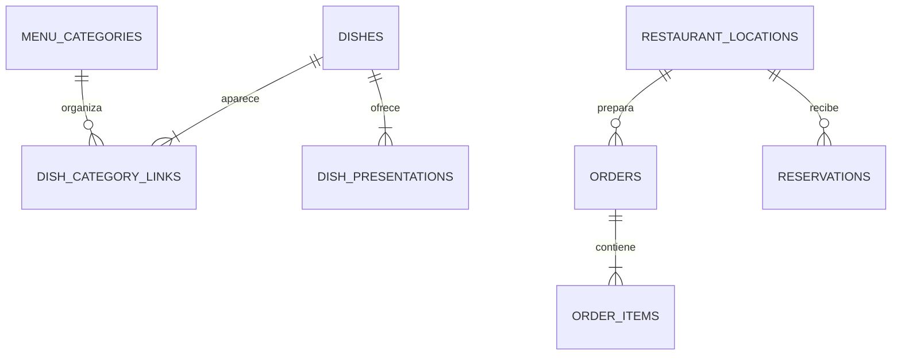

# Diseño de datos compartidos

## Objetivo y decisión

El prototipo conserva datos en LocalStorage, que solo sincroniza dentro del mismo navegador. Para que carta, pedidos, reservas y administración compartan cambios entre dispositivos, se propone PostgreSQL administrado mediante Supabase. La decisión cubre el modelo de datos y las reglas de acceso; la conexión del servicio y la autenticación real todavía no están implementadas.

Los importes se almacenan como enteros en céntimos de sol. Las fechas de recepción usan marcas de tiempo con zona horaria; las fechas de visita se guardan como fecha local del restaurante y la hora como hora local, sin convertirlas a UTC.

## Tablas y relaciones

| Tabla | Campos principales | Reglas |
| --- | --- | --- |
| `menu_categories` | `id`, `name`, `sort_order`, `active` | `id` único; nombre obligatorio. |
| `dishes` | `id`, `name`, `description`, `available`, `created_at`, `updated_at` | Nombre obligatorio; disponibilidad se desactiva sin borrar historial. |
| `dish_category_links` | `dish_id`, `category_id`, `is_primary`, `sort_order` | Une platos y categorías; PK compuesta y una sola categoría principal por plato. Conserva secciones secundarias del menú. |
| `dish_presentations` | `id`, `dish_id`, `name`, `price_cents`, `sort_order` | FK a plato con borrado en cascada solo para presentaciones; precio entero no negativo. |
| `restaurant_locations` | `id`, `name`, `address`, `active` | Catálogo de sedes; el alcance por sede aún requiere confirmación del restaurante. |
| `orders` | `id`, `location_id`, `received_at`, `customer_name`, `phone`, `delivery_method`, `delivery_address`, `status`, `subtotal_cents`, `delivery_fee_cents`, `total_cents` | Estados `pending`, `preparing`, `delivered`, `cancelled`; método `delivery` o `pickup`; importes enteros no negativos. |
| `order_items` | `id`, `order_id`, `dish_id` nullable, `dish_name`, `presentation_name`, `quantity`, `unit_price_cents`, `line_total_cents` | FK a pedido; referencia opcional al plato; copia de nombre y precio para conservar el historial si cambia la carta. Cantidad entera positiva. |
| `reservations` | `id`, `location_id`, `visit_date`, `visit_time`, `customer_name`, `phone`, `people`, `status`, `created_at` | Estados `pending`, `confirmed`, `cancelled`; personas entre 1 y 10 según la regla provisional autorizada. La disponibilidad real requiere duración y control de ocupación aún pendientes. |

Los identificadores serán UUID. Las claves foráneas protegen relaciones y los índices iniciales cubrirán `orders(received_at, status)`, `reservations(visit_date, status)` y las FK. No se elimina físicamente un pedido ni una reserva desde el backoffice.

## Acceso y seguridad

- El público puede leer categorías y platos activos/disponibles, y crear pedidos o solicitudes de reserva válidas. No puede leer datos personales de pedidos ni reservas.
- Un administrador autenticado puede leer y actualizar carta, pedidos y reservas según su rol. Las políticas de Row Level Security (RLS) deben aplicar estas reglas en la base de datos; ocultar botones en React no es una medida de autorización.
- Las solicitudes públicas deben validar en servidor los campos, estados iniciales, cantidades, disponibilidad, precios y totales. El servidor vuelve a calcular importes con los precios vigentes y no confía en los totales enviados por el navegador.
- La clave `service_role` de Supabase y cualquier secreto permanecen solo en servidor y fuera del repositorio. El cliente usa únicamente una clave pública con RLS habilitado.
- Los cambios de estado permitidos se limitan a las transiciones definidas por el flujo administrativo. Los registros guardan marcas de tiempo y se puede añadir `updated_by` cuando exista identidad real del administrador.

## Validaciones

Las validaciones de interfaz mejoran la experiencia, pero la base de datos y el servidor vuelven a validar. Se verifican UUID, referencias existentes, texto no vacío y longitudes máximas, teléfonos normalizados, importes enteros no negativos, cantidades positivas, valores permitidos de estados y métodos, plato disponible y coherencia entre subtotales y total. Las reservas admiten de 1 a 10 personas; no se confirma disponibilidad mientras no se definan duración de turnos, aforo aplicable por sede y reglas de ocupación simultánea.

Los nombres y precios incluidos en `order_items` son instantáneas históricas. Cambiar o desactivar un plato no debe modificar pedidos ya recibidos.

## Estado y siguiente paso

La implementación actual sigue usando datos simulados y LocalStorage en el navegador; no hay conexión con Supabase ni autenticación real. El día 46 configura el entorno de desarrollo y variables sin secretos en Git. Antes de habilitar escrituras públicas se deben implementar RLS, validación del lado servidor, autenticación administrativa y pruebas contra un entorno aislado.
